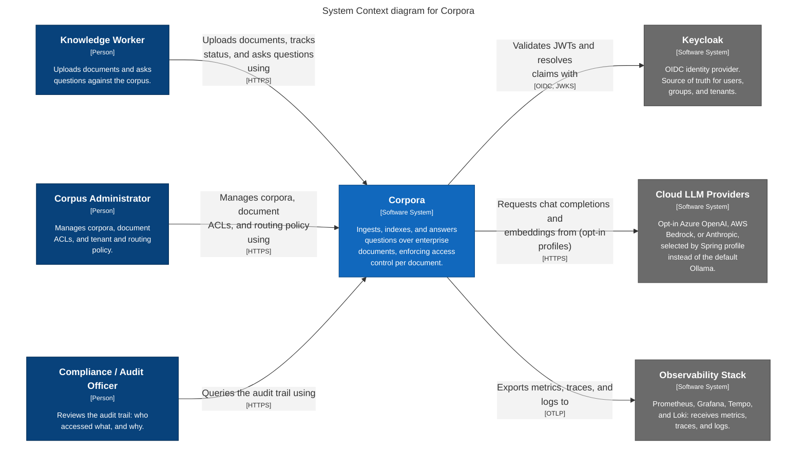

# 3. Context and scope

## 3.1 Business context

<!-- generated from docs/architecture/workspace.dsl, view "context"; do not edit by hand -->

Key: each box prints its type. Dark blue = person. Blue = Corpora. Grey = external system. Arrow = dependency from the initiator to the target, labelled with intent and `[protocol]`.

View key `context` in [`workspace.dsl`](../workspace.dsl).

### Where the system boundary lies

Rule used throughout this documentation:

- A **container of Corpora** is a separately runnable application or data store that Corpora's own Docker Compose deployment runs and that Corpora cannot work without. This includes vendored images (Kafka, MinIO, Docling Serve, Ollama, Apicurio Registry) and every Postgres instance.
- An **external system** is a platform capability that holds no Corpora domain data and takes no part in Corpora's own processing: the identity provider, the observability stack, and the opt-in cloud model providers.

Consequence: Keycloak is external because it is the source of truth for users, groups, and tenants (ADR-0005), not for documents. MinIO, Docling Serve, and Ollama are containers because Corpora's documents and processing steps live in them.

### Communication partners

| Partner | Input to Corpora | Output from Corpora | Channel |
|---|---|---|---|
| Knowledge Worker | Documents to upload; chat questions; status and delete requests | Upload outcome; document status; streamed answer with citations | HTTPS through the API Gateway; chat answers as server-sent events |
| Corpus Administrator | Management of corpora, document ACLs, tenant and routing policy | Unknown | HTTPS. **Unknown:** no API or service for these functions is defined in the design (see [§11](11-risks-and-technical-debt.md), R-8) |
| Compliance / Audit Officer | Audit queries | Audit records: who accessed what, and why | HTTPS. Audit Service offers a read-only query API; **Unknown:** how a caller reaches it, because the design defines no gateway route (R-8) |
| Keycloak | Signing keys (JWKS); user, group, and tenant claims inside the JWT presented by the user | Nothing beyond key requests | OIDC, HTTPS (JWKS), requested by the API Gateway |
| Cloud LLM Providers (opt-in) | Chat completions and embeddings | Prompts and chunk or query text | HTTPS, active only after a Spring profile change (ADR-0004) |
| Observability Stack | Nothing | Metrics, traces, logs | OTLP |

Risky interfaces:

- **Cloud LLM Providers.** With a cloud profile active, document text and queries leave the self-hosted boundary. The default profile uses Ollama and makes no external calls (ADR-0004).
- **Corpus Administrator and Compliance Officer.** Both are drawn as users, but their entry path into the system is undefined.

## 3.2 Technical context

| Interface | Between | Protocol | Notes |
|---|---|---|---|
| User traffic | Users and API Gateway | HTTPS | Gateway terminates TLS and validates the JWT at the edge |
| Token key retrieval | API Gateway and Keycloak | HTTPS (JWKS) | |
| Upload | API Gateway and Ingestion Service | HTTP multipart | Reactive, streamed to MinIO without buffering |
| Status, list, delete | API Gateway and Document Catalog & Lifecycle Service | HTTP/REST | |
| Chat | API Gateway and Query Processor Service | gRPC server streaming | The Gateway translates SSE to gRPC streaming. Tenant, ACL groups, and classification ceiling travel as trusted gRPC metadata |
| Write-side events | Services and Kafka | Kafka protocol | Schemas in the registry; see [events reference](../../reference/events.md) |
| Read-side calls | Query Processor Service and downstream services | gRPC | One propagated deadline |
| Model calls | Services and Ollama or cloud providers | HTTP/REST, HTTPS | Provider chosen by `spring.ai.model.chat` and `spring.ai.model.embedding` (ADR-0004) |
| Telemetry | All application containers and the observability stack | OTLP | |

Internal topology is in [§5](05-building-block-view.md) and [§7](07-deployment-view.md).
