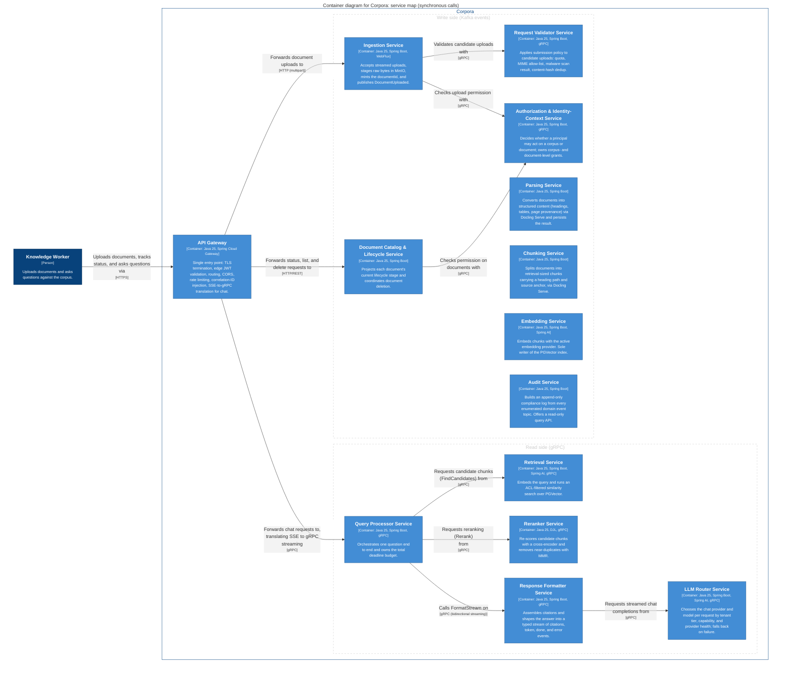

# 5. Building block view

Every diagram below is generated from [`workspace.dsl`](../workspace.dsl). Reading key for all container and component diagrams: each box prints its type and technology in brackets. Solid arrow = synchronous call from caller to callee. Dashed arrow = asynchronous event through Kafka. Cylinder = database. Grey = external system. Dashed boxes group the write side (Kafka events) and the read side (gRPC). Arrow labels state intent, then `[protocol]`. Kafka topics and events appear in labels, not as boxes.

## 5.1 Level 1: containers of Corpora

Decomposition rule: services owned by the Corpora team are containers of the software system Corpora. The vendored runnable images Corpora deploys and depends on are containers too. Platform capabilities that hold no Corpora domain data are external ([§3.1](03-context-and-scope.md#31-business-context)).

Motivation: one service per bounded context for independent deployability and scaling (ADR-0001); Kafka between write-side contexts, gRPC between read-side contexts (ADR-0002); one Postgres instance per data owner (ADR-0012).

### Service map (synchronous calls)

<!-- generated from docs/architecture/workspace.dsl, view "containers"; do not edit by hand -->

View key `containers`. Parsing, Chunking, Embedding, and Audit have no synchronous caller among the services: they are driven only by Kafka events.

### Write side: events

```mermaid
graph LR
  linkStyle default fill:#ffffff

  subgraph diagram ["Container diagram for Corpora: write-side events"]
    style diagram fill:#ffffff,stroke:#ffffff

    subgraph 7 ["Corpora"]
      style 7 fill:#ffffff,stroke:#0b4884,color:#0b4884

      subgraph group1 ["Write side (Kafka events)"]
        style group1 fill:#ffffff,stroke:#cccccc,color:#cccccc,stroke-dasharray:5

        10["<div style='font-weight: bold'>Request Validator Service</div><div style='font-size: 70%; margin-top: 0px'>[Container: Java 25, Spring Boot, gRPC]</div><div style='font-size: 80%; margin-top:10px'>Applies submission policy to<br />candidate uploads: quota,<br />MIME allow-list, malware scan<br />result, content-hash dedup.</div>"]
        style 10 fill:#438dd5,stroke:#2e6295,color:#ffffff
        11["<div style='font-weight: bold'>Ingestion Service</div><div style='font-size: 70%; margin-top: 0px'>[Container: Java 25, Spring Boot, WebFlux]</div><div style='font-size: 80%; margin-top:10px'>Accepts streamed uploads,<br />stages raw bytes in MinIO,<br />mints the documentId, and<br />publishes DocumentUploaded.</div>"]
        style 11 fill:#438dd5,stroke:#2e6295,color:#ffffff
        18["<div style='font-weight: bold'>Parsing Service</div><div style='font-size: 70%; margin-top: 0px'>[Container: Java 25, Spring Boot]</div><div style='font-size: 80%; margin-top:10px'>Converts documents into<br />structured content (headings,<br />tables, page provenance) via<br />Docling Serve and persists<br />the result.</div>"]
        style 18 fill:#438dd5,stroke:#2e6295,color:#ffffff
        19["<div style='font-weight: bold'>Chunking Service</div><div style='font-size: 70%; margin-top: 0px'>[Container: Java 25, Spring Boot]</div><div style='font-size: 80%; margin-top:10px'>Splits documents into<br />retrieval-sized chunks<br />carrying a heading path and<br />source anchor, via Docling<br />Serve.</div>"]
        style 19 fill:#438dd5,stroke:#2e6295,color:#ffffff
        20["<div style='font-weight: bold'>Embedding Service</div><div style='font-size: 70%; margin-top: 0px'>[Container: Java 25, Spring Boot, Spring AI]</div><div style='font-size: 80%; margin-top:10px'>Embeds chunks with the active<br />embedding provider. Sole<br />writer of the PGVector index.</div>"]
        style 20 fill:#438dd5,stroke:#2e6295,color:#ffffff
        21["<div style='font-weight: bold'>Document Catalog & Lifecycle Service</div><div style='font-size: 70%; margin-top: 0px'>[Container: Java 25, Spring Boot]</div><div style='font-size: 80%; margin-top:10px'>Projects each document's<br />current lifecycle stage and<br />coordinates document<br />deletion.</div>"]
        style 21 fill:#438dd5,stroke:#2e6295,color:#ffffff
        22["<div style='font-weight: bold'>Audit Service</div><div style='font-size: 70%; margin-top: 0px'>[Container: Java 25, Spring Boot]</div><div style='font-size: 80%; margin-top:10px'>Builds an append-only<br />compliance log from every<br />enumerated domain event<br />topic. Offers a read-only<br />query API.</div>"]
        style 22 fill:#438dd5,stroke:#2e6295,color:#ffffff
        9["<div style='font-weight: bold'>Authorization & Identity-Context Service</div><div style='font-size: 70%; margin-top: 0px'>[Container: Java 25, Spring Boot, gRPC]</div><div style='font-size: 80%; margin-top:10px'>Decides whether a principal<br />may act on a corpus or<br />document; owns corpus- and<br />document-level grants.</div>"]
        style 9 fill:#438dd5,stroke:#2e6295,color:#ffffff
      end

      44["<div style='font-weight: bold'>Kafka</div><div style='font-size: 70%; margin-top: 0px'>[Container: Apache Kafka (KRaft)]</div><div style='font-size: 80%; margin-top:10px'>Event backbone. Retains<br />events for replay; documentId<br />is the partition key. Hosts<br />retry topics and per-topic<br />DLQs.</div>"]
      style 44 fill:#438dd5,stroke:#2e6295,color:#ffffff
    end

    18-. "<div>Publishes DocumentParsed and<br />DocumentParsingFailed via<br />outbox relay to</div><div style='font-size: 70%'>[Kafka protocol]</div>" .->44
    19-. "<div>Publishes ChunkCreated,<br />DocumentChunked, and<br />DocumentChunkingFailed via<br />outbox relay to</div><div style='font-size: 70%'>[Kafka protocol]</div>" .->44
    20-. "<div>Publishes ChunkEmbedded,<br />ChunkEmbeddingFailed, and<br />DocumentEmbeddingCompleted<br />via outbox relay to</div><div style='font-size: 70%'>[Kafka protocol]</div>" .->44
    21-. "<div>Publishes<br />DocumentDeletionRequested and<br />DocumentDeleted via outbox<br />relay to</div><div style='font-size: 70%'>[Kafka protocol]</div>" .->44
    44-. "<div>Delivers DocumentUploaded and<br />DocumentDeletionRequested to</div><div style='font-size: 70%'>[Kafka protocol]</div>" .->18
    44-. "<div>Delivers DocumentParsed and<br />DocumentDeletionRequested to</div><div style='font-size: 70%'>[Kafka protocol]</div>" .->19
    44-. "<div>Delivers ChunkCreated and<br />DocumentDeletionRequested to</div><div style='font-size: 70%'>[Kafka protocol]</div>" .->20
    44-. "<div>Delivers<br />DocumentDeletionRequested to</div><div style='font-size: 70%'>[Kafka protocol]</div>" .->11
    44-. "<div>Delivers upload, parse,<br />chunk, and embedding<br />lifecycle events and their<br />failures to</div><div style='font-size: 70%'>[Kafka protocol]</div>" .->21
    44-. "<div>Delivers every audited domain<br />event to</div><div style='font-size: 70%'>[Kafka protocol]</div>" .->22
    11-. "<div>Publishes DocumentUploaded<br />via outbox relay to</div><div style='font-size: 70%'>[Kafka protocol]</div>" .->44
    10-. "<div>Publishes<br />DocumentUploadRejected via<br />outbox relay to</div><div style='font-size: 70%'>[Kafka protocol]</div>" .->44
    9-. "<div>Publishes AccessGranted and<br />AccessDenied via outbox relay<br />to</div><div style='font-size: 70%'>[Kafka protocol]</div>" .->44

  end
```

<!-- generated from docs/architecture/workspace.dsl, view "containers-write-events"; do not edit by hand -->

View key `containers-write-events`. Synchronous calls between services are omitted here and shown in the service map.

### Write side: processing dependencies

```mermaid
graph LR
  linkStyle default fill:#ffffff

  subgraph diagram ["Container diagram for Corpora: write-side processing dependencies"]
    style diagram fill:#ffffff,stroke:#ffffff

    5["<div style='font-weight: bold'>Cloud LLM Providers</div><div style='font-size: 70%; margin-top: 0px'>[Software System]</div><div style='font-size: 80%; margin-top:10px'>Opt-in Azure OpenAI, AWS<br />Bedrock, or Anthropic,<br />selected by Spring profile<br />instead of the default<br />Ollama.</div>"]
    style 5 fill:#6b6b6b,stroke:#4a4a4a,color:#ffffff

    subgraph 7 ["Corpora"]
      style 7 fill:#ffffff,stroke:#0b4884,color:#0b4884

      subgraph group1 ["Write side (Kafka events)"]
        style group1 fill:#ffffff,stroke:#cccccc,color:#cccccc,stroke-dasharray:5

        11["<div style='font-weight: bold'>Ingestion Service</div><div style='font-size: 70%; margin-top: 0px'>[Container: Java 25, Spring Boot, WebFlux]</div><div style='font-size: 80%; margin-top:10px'>Accepts streamed uploads,<br />stages raw bytes in MinIO,<br />mints the documentId, and<br />publishes DocumentUploaded.</div>"]
        style 11 fill:#438dd5,stroke:#2e6295,color:#ffffff
        18["<div style='font-weight: bold'>Parsing Service</div><div style='font-size: 70%; margin-top: 0px'>[Container: Java 25, Spring Boot]</div><div style='font-size: 80%; margin-top:10px'>Converts documents into<br />structured content (headings,<br />tables, page provenance) via<br />Docling Serve and persists<br />the result.</div>"]
        style 18 fill:#438dd5,stroke:#2e6295,color:#ffffff
        19["<div style='font-weight: bold'>Chunking Service</div><div style='font-size: 70%; margin-top: 0px'>[Container: Java 25, Spring Boot]</div><div style='font-size: 80%; margin-top:10px'>Splits documents into<br />retrieval-sized chunks<br />carrying a heading path and<br />source anchor, via Docling<br />Serve.</div>"]
        style 19 fill:#438dd5,stroke:#2e6295,color:#ffffff
        20["<div style='font-weight: bold'>Embedding Service</div><div style='font-size: 70%; margin-top: 0px'>[Container: Java 25, Spring Boot, Spring AI]</div><div style='font-size: 80%; margin-top:10px'>Embeds chunks with the active<br />embedding provider. Sole<br />writer of the PGVector index.</div>"]
        style 20 fill:#438dd5,stroke:#2e6295,color:#ffffff
      end

      46["<div style='font-weight: bold'>MinIO</div><div style='font-size: 70%; margin-top: 0px'>[Container: MinIO (S3 API)]</div><div style='font-size: 80%; margin-top:10px'>Object storage for raw<br />uploads, extracted content,<br />and chunk manifests.</div>"]
      style 46 fill:#438dd5,stroke:#2e6295,color:#ffffff
      47["<div style='font-weight: bold'>Docling Serve</div><div style='font-size: 70%; margin-top: 0px'>[Container: Docling Serve (Python, vendored image)]</div><div style='font-size: 80%; margin-top:10px'>Vendored<br />document-understanding<br />engine: converts and chunks<br />documents. Official image, no<br />owned code.</div>"]
      style 47 fill:#438dd5,stroke:#2e6295,color:#ffffff
      48["<div style='font-weight: bold'>Ollama</div><div style='font-size: 70%; margin-top: 0px'>[Container: Ollama]</div><div style='font-size: 80%; margin-top:10px'>Default self-hosted chat and<br />embedding model runtime.</div>"]
      style 48 fill:#438dd5,stroke:#2e6295,color:#ffffff
      54[("<div style='font-weight: bold'>embedding-db</div><div style='font-size: 70%; margin-top: 0px'>[Container: PostgreSQL, pgvector]</div><div style='font-size: 80%; margin-top:10px'>Embedding Service bookkeeping<br />and its outbox, plus the<br />shared PGVector index.<br />Written by Embedding Service<br />only; read by Retrieval<br />Service.</div>")]
      style 54 fill:#438dd5,stroke:#2e6295,color:#ffffff
    end

    11-- "<div>Streams raw uploads to</div><div style='font-size: 70%'>[S3 API]</div>" -->46
    18-- "<div>Reads originals from and<br />stores extracted content in</div><div style='font-size: 70%'>[S3 API]</div>" -->46
    19-- "<div>Reads originals from and<br />stores chunk manifests in</div><div style='font-size: 70%'>[S3 API]</div>" -->46
    18-- "<div>Requests document conversion<br />from</div><div style='font-size: 70%'>[HTTP/REST]</div>" -->47
    19-- "<div>Requests hybrid chunking from</div><div style='font-size: 70%'>[HTTP/REST]</div>" -->47
    20-- "<div>Requests chunk embeddings<br />from</div><div style='font-size: 70%'>[HTTP/REST]</div>" -->48
    20-- "<div>Requests chunk embeddings<br />from (opt-in profile)</div><div style='font-size: 70%'>[HTTPS]</div>" -->5
    20-- "<div>Writes chunk vectors and<br />bookkeeping to</div><div style='font-size: 70%'>[JDBC]</div>" -->54

  end
```

<!-- generated from docs/architecture/workspace.dsl, view "containers-write-processing"; do not edit by hand -->

View key `containers-write-processing`. Parsing Service and Chunking Service each call Docling Serve against the same source, because Docling Serve's chunk endpoint does not accept a pre-parsed document (ADR-0006).

### Read side

```mermaid
graph TB
  linkStyle default fill:#ffffff

  subgraph diagram ["Container diagram for Corpora: read side"]
    style diagram fill:#ffffff,stroke:#ffffff

    1["<div style='font-weight: bold'>Knowledge Worker</div><div style='font-size: 70%; margin-top: 0px'>[Person]</div><div style='font-size: 80%; margin-top:10px'>Uploads documents and asks<br />questions against the corpus.</div>"]
    style 1 fill:#08427b,stroke:#052e56,color:#ffffff
    4["<div style='font-weight: bold'>Keycloak</div><div style='font-size: 70%; margin-top: 0px'>[Software System]</div><div style='font-size: 80%; margin-top:10px'>OIDC identity provider.<br />Source of truth for users,<br />groups, and tenants.</div>"]
    style 4 fill:#6b6b6b,stroke:#4a4a4a,color:#ffffff
    5["<div style='font-weight: bold'>Cloud LLM Providers</div><div style='font-size: 70%; margin-top: 0px'>[Software System]</div><div style='font-size: 80%; margin-top:10px'>Opt-in Azure OpenAI, AWS<br />Bedrock, or Anthropic,<br />selected by Spring profile<br />instead of the default<br />Ollama.</div>"]
    style 5 fill:#6b6b6b,stroke:#4a4a4a,color:#ffffff

    subgraph 7 ["Corpora"]
      style 7 fill:#ffffff,stroke:#0b4884,color:#0b4884

      subgraph group1 ["Read side (gRPC)"]
        style group1 fill:#ffffff,stroke:#cccccc,color:#cccccc,stroke-dasharray:5

        23["<div style='font-weight: bold'>Query Processor Service</div><div style='font-size: 70%; margin-top: 0px'>[Container: Java 25, Spring Boot, gRPC]</div><div style='font-size: 80%; margin-top:10px'>Orchestrates one question end<br />to end and owns the total<br />deadline budget.</div>"]
        style 23 fill:#438dd5,stroke:#2e6295,color:#ffffff
        34["<div style='font-weight: bold'>Retrieval Service</div><div style='font-size: 70%; margin-top: 0px'>[Container: Java 25, Spring Boot, Spring AI, gRPC]</div><div style='font-size: 80%; margin-top:10px'>Embeds the query and runs an<br />ACL-filtered similarity<br />search over PGVector.</div>"]
        style 34 fill:#438dd5,stroke:#2e6295,color:#ffffff
        41["<div style='font-weight: bold'>Reranker Service</div><div style='font-size: 70%; margin-top: 0px'>[Container: Java 25, DJL, gRPC]</div><div style='font-size: 80%; margin-top:10px'>Re-scores candidate chunks<br />with a cross-encoder and<br />removes near-duplicates with<br />MMR.</div>"]
        style 41 fill:#438dd5,stroke:#2e6295,color:#ffffff
        42["<div style='font-weight: bold'>Response Formatter Service</div><div style='font-size: 70%; margin-top: 0px'>[Container: Java 25, Spring Boot, gRPC]</div><div style='font-size: 80%; margin-top:10px'>Assembles citations and<br />shapes the answer into a<br />typed stream of citations,<br />token, done, and error<br />events.</div>"]
        style 42 fill:#438dd5,stroke:#2e6295,color:#ffffff
        43["<div style='font-weight: bold'>LLM Router Service</div><div style='font-size: 70%; margin-top: 0px'>[Container: Java 25, Spring Boot, Spring AI, gRPC]</div><div style='font-size: 80%; margin-top:10px'>Chooses the chat provider and<br />model per request by tenant<br />tier, capability, and<br />provider health; falls back<br />on failure.</div>"]
        style 43 fill:#438dd5,stroke:#2e6295,color:#ffffff
      end

      44["<div style='font-weight: bold'>Kafka</div><div style='font-size: 70%; margin-top: 0px'>[Container: Apache Kafka (KRaft)]</div><div style='font-size: 80%; margin-top:10px'>Event backbone. Retains<br />events for replay; documentId<br />is the partition key. Hosts<br />retry topics and per-topic<br />DLQs.</div>"]
      style 44 fill:#438dd5,stroke:#2e6295,color:#ffffff
      48["<div style='font-weight: bold'>Ollama</div><div style='font-size: 70%; margin-top: 0px'>[Container: Ollama]</div><div style='font-size: 80%; margin-top:10px'>Default self-hosted chat and<br />embedding model runtime.</div>"]
      style 48 fill:#438dd5,stroke:#2e6295,color:#ffffff
      54[("<div style='font-weight: bold'>embedding-db</div><div style='font-size: 70%; margin-top: 0px'>[Container: PostgreSQL, pgvector]</div><div style='font-size: 80%; margin-top:10px'>Embedding Service bookkeeping<br />and its outbox, plus the<br />shared PGVector index.<br />Written by Embedding Service<br />only; read by Retrieval<br />Service.</div>")]
      style 54 fill:#438dd5,stroke:#2e6295,color:#ffffff
      8["<div style='font-weight: bold'>API Gateway</div><div style='font-size: 70%; margin-top: 0px'>[Container: Java 25, Spring Cloud Gateway]</div><div style='font-size: 80%; margin-top:10px'>Single entry point: TLS<br />termination, edge JWT<br />validation, routing, CORS,<br />rate limiting, correlation-ID<br />injection, SSE-to-gRPC<br />translation for chat.</div>"]
      style 8 fill:#438dd5,stroke:#2e6295,color:#ffffff
    end

    23-. "<div>Publishes QueryReceived,<br />QueryRewritten, and<br />QueryAnswered,<br />fire-and-forget, to</div><div style='font-size: 70%'>[Kafka protocol]</div>" .->44
    34-. "<div>Publishes ChunksRetrieved,<br />fire-and-forget, to</div><div style='font-size: 70%'>[Kafka protocol]</div>" .->44
    41-. "<div>Publishes RerankPerformed,<br />fire-and-forget, to</div><div style='font-size: 70%'>[Kafka protocol]</div>" .->44
    43-. "<div>Publishes LlmInvoked,<br />fire-and-forget, to</div><div style='font-size: 70%'>[Kafka protocol]</div>" .->44
    42-. "<div>Publishes ResponseFormatted,<br />fire-and-forget, to</div><div style='font-size: 70%'>[Kafka protocol]</div>" .->44
    1-- "<div>Uploads documents, tracks<br />status, and asks questions<br />via</div><div style='font-size: 70%'>[HTTPS]</div>" -->8
    8-- "<div>Fetches signing keys to<br />validate access tokens from</div><div style='font-size: 70%'>[HTTPS (JWKS)]</div>" -->4
    8-- "<div>Forwards chat requests to,<br />translating SSE to gRPC<br />streaming</div><div style='font-size: 70%'>[gRPC]</div>" -->23
    23-- "<div>Requests candidate chunks<br />(FindCandidates) from</div><div style='font-size: 70%'>[gRPC]</div>" -->34
    23-- "<div>Requests reranking (Rerank)<br />from</div><div style='font-size: 70%'>[gRPC]</div>" -->41
    23-- "<div>Calls FormatStream on</div><div style='font-size: 70%'>[gRPC (bidirectional streaming)]</div>" -->42
    42-- "<div>Requests streamed chat<br />completions from</div><div style='font-size: 70%'>[gRPC]</div>" -->43
    34-- "<div>Requests query embeddings<br />from</div><div style='font-size: 70%'>[HTTP/REST]</div>" -->48
    34-- "<div>Requests query embeddings<br />from (opt-in profile)</div><div style='font-size: 70%'>[HTTPS]</div>" -->5
    34-- "<div>Reads vectors by ACL-filtered<br />similarity search from<br />(read-only DB role)</div><div style='font-size: 70%'>[JDBC]</div>" -->54
    43-- "<div>Requests chat completions<br />from</div><div style='font-size: 70%'>[HTTP/REST]</div>" -->48
    43-- "<div>Requests chat completions<br />from (opt-in profile)</div><div style='font-size: 70%'>[HTTPS]</div>" -->5

  end
```

<!-- generated from docs/architecture/workspace.dsl, view "containers-read-side"; do not edit by hand -->

View key `containers-read-side`. Read-side services publish audit events to Kafka fire-and-forget. The arrow from Retrieval Service into `embedding-db`, labelled "read-only DB role", is the single cross-service database access in the system.

### Data ownership

```mermaid
graph LR
  linkStyle default fill:#ffffff

  subgraph diagram ["Container diagram for Corpora: data ownership"]
    style diagram fill:#ffffff,stroke:#ffffff

    subgraph 7 ["Corpora"]
      style 7 fill:#ffffff,stroke:#0b4884,color:#0b4884

      subgraph group1 ["Read side (gRPC)"]
        style group1 fill:#ffffff,stroke:#cccccc,color:#cccccc,stroke-dasharray:5

        34["<div style='font-weight: bold'>Retrieval Service</div><div style='font-size: 70%; margin-top: 0px'>[Container: Java 25, Spring Boot, Spring AI, gRPC]</div><div style='font-size: 80%; margin-top:10px'>Embeds the query and runs an<br />ACL-filtered similarity<br />search over PGVector.</div>"]
        style 34 fill:#438dd5,stroke:#2e6295,color:#ffffff
        43["<div style='font-weight: bold'>LLM Router Service</div><div style='font-size: 70%; margin-top: 0px'>[Container: Java 25, Spring Boot, Spring AI, gRPC]</div><div style='font-size: 80%; margin-top:10px'>Chooses the chat provider and<br />model per request by tenant<br />tier, capability, and<br />provider health; falls back<br />on failure.</div>"]
        style 43 fill:#438dd5,stroke:#2e6295,color:#ffffff
      end

      subgraph group2 ["Write side (Kafka events)"]
        style group2 fill:#ffffff,stroke:#cccccc,color:#cccccc,stroke-dasharray:5

        10["<div style='font-weight: bold'>Request Validator Service</div><div style='font-size: 70%; margin-top: 0px'>[Container: Java 25, Spring Boot, gRPC]</div><div style='font-size: 80%; margin-top:10px'>Applies submission policy to<br />candidate uploads: quota,<br />MIME allow-list, malware scan<br />result, content-hash dedup.</div>"]
        style 10 fill:#438dd5,stroke:#2e6295,color:#ffffff
        11["<div style='font-weight: bold'>Ingestion Service</div><div style='font-size: 70%; margin-top: 0px'>[Container: Java 25, Spring Boot, WebFlux]</div><div style='font-size: 80%; margin-top:10px'>Accepts streamed uploads,<br />stages raw bytes in MinIO,<br />mints the documentId, and<br />publishes DocumentUploaded.</div>"]
        style 11 fill:#438dd5,stroke:#2e6295,color:#ffffff
        18["<div style='font-weight: bold'>Parsing Service</div><div style='font-size: 70%; margin-top: 0px'>[Container: Java 25, Spring Boot]</div><div style='font-size: 80%; margin-top:10px'>Converts documents into<br />structured content (headings,<br />tables, page provenance) via<br />Docling Serve and persists<br />the result.</div>"]
        style 18 fill:#438dd5,stroke:#2e6295,color:#ffffff
        19["<div style='font-weight: bold'>Chunking Service</div><div style='font-size: 70%; margin-top: 0px'>[Container: Java 25, Spring Boot]</div><div style='font-size: 80%; margin-top:10px'>Splits documents into<br />retrieval-sized chunks<br />carrying a heading path and<br />source anchor, via Docling<br />Serve.</div>"]
        style 19 fill:#438dd5,stroke:#2e6295,color:#ffffff
        20["<div style='font-weight: bold'>Embedding Service</div><div style='font-size: 70%; margin-top: 0px'>[Container: Java 25, Spring Boot, Spring AI]</div><div style='font-size: 80%; margin-top:10px'>Embeds chunks with the active<br />embedding provider. Sole<br />writer of the PGVector index.</div>"]
        style 20 fill:#438dd5,stroke:#2e6295,color:#ffffff
        21["<div style='font-weight: bold'>Document Catalog & Lifecycle Service</div><div style='font-size: 70%; margin-top: 0px'>[Container: Java 25, Spring Boot]</div><div style='font-size: 80%; margin-top:10px'>Projects each document's<br />current lifecycle stage and<br />coordinates document<br />deletion.</div>"]
        style 21 fill:#438dd5,stroke:#2e6295,color:#ffffff
        22["<div style='font-weight: bold'>Audit Service</div><div style='font-size: 70%; margin-top: 0px'>[Container: Java 25, Spring Boot]</div><div style='font-size: 80%; margin-top:10px'>Builds an append-only<br />compliance log from every<br />enumerated domain event<br />topic. Offers a read-only<br />query API.</div>"]
        style 22 fill:#438dd5,stroke:#2e6295,color:#ffffff
        9["<div style='font-weight: bold'>Authorization & Identity-Context Service</div><div style='font-size: 70%; margin-top: 0px'>[Container: Java 25, Spring Boot, gRPC]</div><div style='font-size: 80%; margin-top:10px'>Decides whether a principal<br />may act on a corpus or<br />document; owns corpus- and<br />document-level grants.</div>"]
        style 9 fill:#438dd5,stroke:#2e6295,color:#ffffff
      end

      49[("<div style='font-weight: bold'>authorization-db</div><div style='font-size: 70%; margin-top: 0px'>[Container: PostgreSQL]</div><div style='font-size: 80%; margin-top:10px'>Private store of<br />Authorization &<br />Identity-Context Service:<br />corpus- and document-level<br />grants and its outbox.</div>")]
      style 49 fill:#438dd5,stroke:#2e6295,color:#ffffff
      50[("<div style='font-weight: bold'>request-validator-db</div><div style='font-size: 70%; margin-top: 0px'>[Container: PostgreSQL]</div><div style='font-size: 80%; margin-top:10px'>Private store of Request<br />Validator Service and its<br />outbox.</div>")]
      style 50 fill:#438dd5,stroke:#2e6295,color:#ffffff
      51[("<div style='font-weight: bold'>ingestion-db</div><div style='font-size: 70%; margin-top: 0px'>[Container: PostgreSQL]</div><div style='font-size: 80%; margin-top:10px'>Private store of Ingestion<br />Service: Upload aggregate and<br />its outbox.</div>")]
      style 51 fill:#438dd5,stroke:#2e6295,color:#ffffff
      52[("<div style='font-weight: bold'>parsing-db</div><div style='font-size: 70%; margin-top: 0px'>[Container: PostgreSQL]</div><div style='font-size: 80%; margin-top:10px'>Private store of Parsing<br />Service: parse-job<br />bookkeeping and its outbox.</div>")]
      style 52 fill:#438dd5,stroke:#2e6295,color:#ffffff
      53[("<div style='font-weight: bold'>chunking-db</div><div style='font-size: 70%; margin-top: 0px'>[Container: PostgreSQL]</div><div style='font-size: 80%; margin-top:10px'>Private store of Chunking<br />Service and its outbox.</div>")]
      style 53 fill:#438dd5,stroke:#2e6295,color:#ffffff
      54[("<div style='font-weight: bold'>embedding-db</div><div style='font-size: 70%; margin-top: 0px'>[Container: PostgreSQL, pgvector]</div><div style='font-size: 80%; margin-top:10px'>Embedding Service bookkeeping<br />and its outbox, plus the<br />shared PGVector index.<br />Written by Embedding Service<br />only; read by Retrieval<br />Service.</div>")]
      style 54 fill:#438dd5,stroke:#2e6295,color:#ffffff
      55[("<div style='font-weight: bold'>document-catalog-db</div><div style='font-size: 70%; margin-top: 0px'>[Container: PostgreSQL]</div><div style='font-size: 80%; margin-top:10px'>Private store of Document<br />Catalog & Lifecycle Service:<br />one current-state row per<br />document, and its outbox.</div>")]
      style 55 fill:#438dd5,stroke:#2e6295,color:#ffffff
      56[("<div style='font-weight: bold'>audit-db</div><div style='font-size: 70%; margin-top: 0px'>[Container: PostgreSQL]</div><div style='font-size: 80%; margin-top:10px'>Append-only audit log. UPDATE<br />and DELETE grants are<br />revoked.</div>")]
      style 56 fill:#438dd5,stroke:#2e6295,color:#ffffff
      57[("<div style='font-weight: bold'>llm-router-db</div><div style='font-size: 70%; margin-top: 0px'>[Container: PostgreSQL]</div><div style='font-size: 80%; margin-top:10px'>Private store of LLM Router<br />Service: tenant routing<br />policy and circuit-breaker<br />state.</div>")]
      style 57 fill:#438dd5,stroke:#2e6295,color:#ffffff
    end

    20-- "<div>Writes chunk vectors and<br />bookkeeping to</div><div style='font-size: 70%'>[JDBC]</div>" -->54
    34-- "<div>Reads vectors by ACL-filtered<br />similarity search from<br />(read-only DB role)</div><div style='font-size: 70%'>[JDBC]</div>" -->54
    9-- "<div>Reads and writes grants and<br />outbox rows in</div><div style='font-size: 70%'>[JDBC]</div>" -->49
    10-- "<div>Reads and writes submission<br />state and outbox rows in</div><div style='font-size: 70%'>[JDBC]</div>" -->50
    11-- "<div>Reads and writes uploads and<br />outbox rows in</div><div style='font-size: 70%'>[JDBC]</div>" -->51
    18-- "<div>Reads and writes parse jobs<br />and outbox rows in</div><div style='font-size: 70%'>[JDBC]</div>" -->52
    19-- "<div>Reads and writes chunk state<br />and outbox rows in</div><div style='font-size: 70%'>[JDBC]</div>" -->53
    21-- "<div>Reads and writes the document<br />projection and outbox rows in</div><div style='font-size: 70%'>[JDBC]</div>" -->55
    22-- "<div>Appends audit entries to and<br />queries</div><div style='font-size: 70%'>[JDBC]</div>" -->56
    43-- "<div>Reads and writes routing<br />policy and circuit-breaker<br />state in</div><div style='font-size: 70%'>[JDBC]</div>" -->57

  end
```

<!-- generated from docs/architecture/workspace.dsl, view "data-ownership"; do not edit by hand -->

View key `data-ownership`. Each data-owning service has exactly one Postgres instance. Retrieval Service reads `embedding-db` through a read-only database role; Embedding Service is its only writer (ADR-0003, ADR-0012).

### Not drawn

The Schema Registry relationship from every Kafka-using service, and the observability relationship from every application container, exist in the model but are left off the views because they would appear on every picture. See [§8.2](08-crosscutting-concepts.md#82-event-contracts-and-schema-evolution) and [§8.7](08-crosscutting-concepts.md#87-observability).

### Application containers

| Building block | Responsibility | Interfaces | Datastore |
|---|---|---|---|
| API Gateway | Edge: TLS termination, JWT validation, routing, CORS, rate limiting, correlation-ID injection, SSE-to-gRPC translation. No domain model | In: HTTPS. Out: HTTP to Ingestion and Catalog, gRPC to Query Processor, JWKS from Keycloak | None |
| Authorization & Identity-Context Service | Fine-grained, resource-scoped authorization (can this principal act on this corpus or document). Owns grants beyond Keycloak realm roles | In: gRPC. Publishes `AccessGranted`, `AccessDenied` | `authorization-db` |
| Request Validator Service | Submission policy: quota, MIME allow-list, malware scan result, content-hash dedup | In: gRPC. Publishes `DocumentUploadRejected` | `request-validator-db` |
| Ingestion Service | Intake: streamed upload, raw bytes staged in MinIO, `documentId` minted. Its jurisdiction ends at handoff | In: HTTP multipart. Out: gRPC to Validator and Authorization, S3 to MinIO. Publishes `DocumentUploaded`. Consumes `DocumentDeletionRequested` | `ingestion-db` |
| Parsing Service | Structured extraction (headings, tables, page provenance) via Docling Serve; extracted content persisted to MinIO by claim-check | Consumes `DocumentUploaded`, `DocumentDeletionRequested`. Publishes `DocumentParsed`, `DocumentParsingFailed`. Out: REST to Docling Serve, S3 | `parsing-db` |
| Chunking Service | Retrieval-sized chunks with heading path and source anchor; strategy `hybrid` (default) or `hierarchical` | Consumes `DocumentParsed`, `DocumentDeletionRequested`. Publishes `ChunkCreated`, `DocumentChunked`, `DocumentChunkingFailed`. Out: REST to Docling Serve, S3 | `chunking-db` |
| Embedding Service | Embeds chunks with the active provider; sole writer of the PGVector index; counts completion per document | Consumes `ChunkCreated`, `DocumentDeletionRequested`. Publishes `ChunkEmbedded`, `ChunkEmbeddingFailed`, `DocumentEmbeddingCompleted`. Out: HTTP to the model provider | `embedding-db` |
| Document Catalog & Lifecycle Service | Current-state projection per document; deletion saga coordinator. Sole writer of that projection | In: HTTP/REST (status, list, delete). Consumes lifecycle events. Publishes `DocumentDeletionRequested`, `DocumentDeleted`. Out: gRPC to Authorization | `document-catalog-db` |
| Audit Service | Append-only compliance log from an enumerated list of topics | Consumes audited events. In: read-only query API | `audit-db` |
| Query Processor Service | Orchestrates one question: rewrite, retrieve, rerank, format. Owns the total deadline budget | In: gRPC server streaming. Out: gRPC to Retrieval, Reranker, Response Formatter. Publishes `QueryReceived`, `QueryRewritten`, `QueryAnswered` | None |
| Retrieval Service | Embeds the query and runs the ACL-filtered similarity search. Owns the highest-risk logic in the system | In: gRPC unary (`FindCandidates`). Out: model provider, `embedding-db` (read-only). Publishes `ChunksRetrieved` | None of its own |
| Reranker Service | Cross-encoder reordering of a fixed candidate batch; MMR diversity filtering | In: gRPC (`Rerank`). Publishes `RerankPerformed` | None |
| Response Formatter Service | Citation assembly and typed answer stream (`citations`, `token`, `done`, `error`); provider-shape normalisation | In: gRPC bidirectional streaming (`FormatStream`). Out: gRPC to LLM Router. Publishes `ResponseFormatted` | None |
| LLM Router Service | Per-request provider and model choice by tenant tier, capability, and provider health; circuit-breaker fallback | In: gRPC streaming. Out: model provider. Publishes `LlmInvoked` | `llm-router-db` |

Aggregate roots and ubiquitous-language terms for each service are in the [glossary](12-glossary.md).

### Infrastructure containers

| Building block | Purpose | Technology |
|---|---|---|
| Kafka | Write-side event backbone with retained log, retry topics, per-topic DLQs. Partition key `documentId` | Apache Kafka, KRaft |
| Schema Registry | Event schema storage and compatibility | Apicurio Registry |
| MinIO | Raw uploads, extracted content, chunk manifests | MinIO, S3 API |
| Docling Serve | Document conversion and hybrid chunking; vendored image, no owned code | Docling Serve |
| Ollama | Default self-hosted chat and embedding runtime | Ollama |
| Nine Postgres instances | One per data-owning service, named as in the table above. `embedding-db` also hosts pgvector | PostgreSQL |

### Where the code lives

No service module exists yet. `settings.gradle.kts` declares no subprojects; service modules are added as they are scaffolded under a single Gradle multi-module build (ADR-0014). Module names and paths are `Unknown` until then. When a module is created, add its path as a column to the tables above.

## 5.2 Level 2: important building blocks

Three services get a component view because their internals carry architectural weight. Others are standard Spring Boot services and are left out on purpose.

The component views are **design intent**. No code exists and nothing enforces them. When code exists, add an ArchUnit rule that fails when the dependency directions drawn here are violated, or correct the diagram to match the code.

### Ingestion Service: transactional outbox

```mermaid
graph TB
  linkStyle default fill:#ffffff

  subgraph diagram ["Component diagram for Ingestion Service (Corpora)"]
    style diagram fill:#ffffff,stroke:#ffffff

    subgraph 7 ["Corpora"]
      style 7 fill:#ffffff,stroke:#0b4884,color:#0b4884

      subgraph 11 ["Ingestion Service"]
        style 11 fill:#ffffff,stroke:#2e6295,color:#2e6295

        12["<div style='font-weight: bold'>UploadController</div><div style='font-size: 70%; margin-top: 0px'>[Component: Spring WebFlux controller]</div><div style='font-size: 80%; margin-top:10px'>Streams multipart bytes to<br />MinIO without buffering, then<br />validates, authorizes, and<br />commits the upload.</div>"]
        style 12 fill:#85bbf0,stroke:#5d82a8,color:#000000
        13["<div style='font-weight: bold'>RequestValidatorClient</div><div style='font-size: 70%; margin-top: 0px'>[Component: gRPC stub]</div><div style='font-size: 80%; margin-top:10px'>Calls Request Validator<br />Service before the upload<br />commits.</div>"]
        style 13 fill:#85bbf0,stroke:#5d82a8,color:#000000
        14["<div style='font-weight: bold'>AuthorizationClient</div><div style='font-size: 70%; margin-top: 0px'>[Component: gRPC stub]</div><div style='font-size: 80%; margin-top:10px'>Asks Authorization &<br />Identity-Context Service<br />whether the caller may upload<br />to the corpus.</div>"]
        style 14 fill:#85bbf0,stroke:#5d82a8,color:#000000
        15["<div style='font-weight: bold'>UploadService</div><div style='font-size: 70%; margin-top: 0px'>[Component: Domain service]</div><div style='font-size: 80%; margin-top:10px'>Owns the Upload aggregate.<br />Stores the aggregate and its<br />event row in one transaction.</div>"]
        style 15 fill:#85bbf0,stroke:#5d82a8,color:#000000
        16["<div style='font-weight: bold'>TransactionalOutbox</div><div style='font-size: 70%; margin-top: 0px'>[Component: Spring Data JPA, poller]</div><div style='font-size: 80%; margin-top:10px'>Writes events to the outbox<br />table inside the aggregate's<br />transaction; a poller relays<br />them.</div>"]
        style 16 fill:#85bbf0,stroke:#5d82a8,color:#000000
        17["<div style='font-weight: bold'>DocumentUploadedProducer</div><div style='font-size: 70%; margin-top: 0px'>[Component: spring-kafka]</div><div style='font-size: 80%; margin-top:10px'>Publishes relayed outbox rows<br />to Kafka.</div>"]
        style 17 fill:#85bbf0,stroke:#5d82a8,color:#000000
      end

      10["<div style='font-weight: bold'>Request Validator Service</div><div style='font-size: 70%; margin-top: 0px'>[Container: Java 25, Spring Boot, gRPC]</div><div style='font-size: 80%; margin-top:10px'>Applies submission policy to<br />candidate uploads: quota,<br />MIME allow-list, malware scan<br />result, content-hash dedup.</div>"]
      style 10 fill:#438dd5,stroke:#2e6295,color:#ffffff
      44["<div style='font-weight: bold'>Kafka</div><div style='font-size: 70%; margin-top: 0px'>[Container: Apache Kafka (KRaft)]</div><div style='font-size: 80%; margin-top:10px'>Event backbone. Retains<br />events for replay; documentId<br />is the partition key. Hosts<br />retry topics and per-topic<br />DLQs.</div>"]
      style 44 fill:#438dd5,stroke:#2e6295,color:#ffffff
      46["<div style='font-weight: bold'>MinIO</div><div style='font-size: 70%; margin-top: 0px'>[Container: MinIO (S3 API)]</div><div style='font-size: 80%; margin-top:10px'>Object storage for raw<br />uploads, extracted content,<br />and chunk manifests.</div>"]
      style 46 fill:#438dd5,stroke:#2e6295,color:#ffffff
      51[("<div style='font-weight: bold'>ingestion-db</div><div style='font-size: 70%; margin-top: 0px'>[Container: PostgreSQL]</div><div style='font-size: 80%; margin-top:10px'>Private store of Ingestion<br />Service: Upload aggregate and<br />its outbox.</div>")]
      style 51 fill:#438dd5,stroke:#2e6295,color:#ffffff
      8["<div style='font-weight: bold'>API Gateway</div><div style='font-size: 70%; margin-top: 0px'>[Container: Java 25, Spring Cloud Gateway]</div><div style='font-size: 80%; margin-top:10px'>Single entry point: TLS<br />termination, edge JWT<br />validation, routing, CORS,<br />rate limiting, correlation-ID<br />injection, SSE-to-gRPC<br />translation for chat.</div>"]
      style 8 fill:#438dd5,stroke:#2e6295,color:#ffffff
      9["<div style='font-weight: bold'>Authorization & Identity-Context Service</div><div style='font-size: 70%; margin-top: 0px'>[Container: Java 25, Spring Boot, gRPC]</div><div style='font-size: 80%; margin-top:10px'>Decides whether a principal<br />may act on a corpus or<br />document; owns corpus- and<br />document-level grants.</div>"]
      style 9 fill:#438dd5,stroke:#2e6295,color:#ffffff
    end

    8-- "<div>Forwards document uploads to</div><div style='font-size: 70%'>[HTTP (multipart)]</div>" -->12
    12-- "<div>Streams raw bytes to</div><div style='font-size: 70%'>[S3 API]</div>" -->46
    12-- "<div>Validates before commit<br />through</div><div style='font-size: 70%'></div>" -->13
    12-- "<div>Authorizes the upload through</div><div style='font-size: 70%'></div>" -->14
    12-- "<div>Commits the upload through</div><div style='font-size: 70%'></div>" -->15
    13-- "<div>Calls</div><div style='font-size: 70%'>[gRPC]</div>" -->10
    14-- "<div>Calls</div><div style='font-size: 70%'>[gRPC]</div>" -->9
    15-- "<div>Persists the Upload aggregate<br />in</div><div style='font-size: 70%'>[JDBC]</div>" -->51
    15-- "<div>Records DocumentUploaded in<br />the same transaction through</div><div style='font-size: 70%'></div>" -->16
    16-- "<div>Stores and polls outbox rows<br />in</div><div style='font-size: 70%'>[JDBC]</div>" -->51
    16-- "<div>Hands relayed rows to</div><div style='font-size: 70%'></div>" -->17
    17-. "<div>Publishes DocumentUploaded to</div><div style='font-size: 70%'>[Kafka protocol]</div>" .->44
    10-. "<div>Publishes<br />DocumentUploadRejected via<br />outbox relay to</div><div style='font-size: 70%'>[Kafka protocol]</div>" .->44
    9-. "<div>Publishes AccessGranted and<br />AccessDenied via outbox relay<br />to</div><div style='font-size: 70%'>[Kafka protocol]</div>" .->44

  end
```

<!-- generated from docs/architecture/workspace.dsl, view "ingestion-components"; do not edit by hand -->

View key `ingestion-components`. Representative of every write-side producer.

- The `DocumentUploaded` row is written in the same database transaction as the `Upload` aggregate and relayed by a poller. A crash between commit and publish therefore cannot lose the event (dual-write problem).
- Retry: bounded retry with exponential backoff and jitter for transient connection failures to Validator and Authorization. Application errors (bad format, denied) fail fast and are not retried.
- Raw bytes are durable in MinIO before any downstream processing starts, so a failed `PROCESSING` stage can be retried later without a re-upload.

### Query Processor Service: orchestration and deadline

```mermaid
graph TB
  linkStyle default fill:#ffffff

  subgraph diagram ["Component diagram for Query Processor Service (Corpora)"]
    style diagram fill:#ffffff,stroke:#ffffff

    subgraph 7 ["Corpora"]
      style 7 fill:#ffffff,stroke:#0b4884,color:#0b4884

      subgraph 23 ["Query Processor Service"]
        style 23 fill:#ffffff,stroke:#2e6295,color:#2e6295

        24["<div style='font-weight: bold'>ChatStreamEndpoint</div><div style='font-size: 70%; margin-top: 0px'>[Component: gRPC server-streaming]</div><div style='font-size: 80%; margin-top:10px'>Entry point from the Gateway.<br />Receives trusted tenant and<br />ACL claims as gRPC metadata.</div>"]
        style 24 fill:#85bbf0,stroke:#5d82a8,color:#000000
        25["<div style='font-weight: bold'>QueryRewriter</div><div style='font-size: 70%; margin-top: 0px'>[Component: Domain service]</div><div style='font-size: 80%; margin-top:10px'>Resolves pronouns and<br />ellipsis; decomposes the<br />question.</div>"]
        style 25 fill:#85bbf0,stroke:#5d82a8,color:#000000
        26["<div style='font-weight: bold'>IntentClassifier</div><div style='font-size: 70%; margin-top: 0px'>[Component: Domain service]</div><div style='font-size: 80%; margin-top:10px'>Classifies intent: factual,<br />summarization, or comparison.</div>"]
        style 26 fill:#85bbf0,stroke:#5d82a8,color:#000000
        27["<div style='font-weight: bold'>FilterHintExtractor</div><div style='font-size: 70%; margin-top: 0px'>[Component: Domain service]</div><div style='font-size: 80%; margin-top:10px'>Derives an untrusted<br />ExtractedFilterHint that can<br />only narrow results.</div>"]
        style 27 fill:#85bbf0,stroke:#5d82a8,color:#000000
        28["<div style='font-weight: bold'>AnswerOrchestrator</div><div style='font-size: 70%; margin-top: 0px'>[Component: Saga-style coordinator]</div><div style='font-size: 80%; margin-top:10px'>Single owner of the total<br />deadline budget, retry and<br />circuit-breaking logic, and<br />the root trace span.</div>"]
        style 28 fill:#85bbf0,stroke:#5d82a8,color:#000000
        29["<div style='font-weight: bold'>DeadlineManager</div><div style='font-size: 70%; margin-top: 0px'>[Component: gRPC deadlines]</div><div style='font-size: 80%; margin-top:10px'>Propagates the remaining<br />deadline on every downstream<br />gRPC call.</div>"]
        style 29 fill:#85bbf0,stroke:#5d82a8,color:#000000
        30["<div style='font-weight: bold'>RetrievalClient</div><div style='font-size: 70%; margin-top: 0px'>[Component: gRPC stub]</div><div style='font-size: 80%; margin-top:10px'>Calls FindCandidates on<br />Retrieval Service.</div>"]
        style 30 fill:#85bbf0,stroke:#5d82a8,color:#000000
        31["<div style='font-weight: bold'>RerankerClient</div><div style='font-size: 70%; margin-top: 0px'>[Component: gRPC stub]</div><div style='font-size: 80%; margin-top:10px'>Calls Rerank on Reranker<br />Service.</div>"]
        style 31 fill:#85bbf0,stroke:#5d82a8,color:#000000
        32["<div style='font-weight: bold'>ResponseFormatterClient</div><div style='font-size: 70%; margin-top: 0px'>[Component: gRPC bidirectional stub]</div><div style='font-size: 80%; margin-top:10px'>Calls FormatStream on<br />Response Formatter Service.</div>"]
        style 32 fill:#85bbf0,stroke:#5d82a8,color:#000000
        33["<div style='font-weight: bold'>AsyncAuditPublisher</div><div style='font-size: 70%; margin-top: 0px'>[Component: spring-kafka, fire-and-forget]</div><div style='font-size: 80%; margin-top:10px'>Publishes QueryReceived,<br />QueryRewritten, QueryAnswered<br />without ever blocking the<br />response.</div>"]
        style 33 fill:#85bbf0,stroke:#5d82a8,color:#000000
      end

      34["<div style='font-weight: bold'>Retrieval Service</div><div style='font-size: 70%; margin-top: 0px'>[Container: Java 25, Spring Boot, Spring AI, gRPC]</div><div style='font-size: 80%; margin-top:10px'>Embeds the query and runs an<br />ACL-filtered similarity<br />search over PGVector.</div>"]
      style 34 fill:#438dd5,stroke:#2e6295,color:#ffffff
      41["<div style='font-weight: bold'>Reranker Service</div><div style='font-size: 70%; margin-top: 0px'>[Container: Java 25, DJL, gRPC]</div><div style='font-size: 80%; margin-top:10px'>Re-scores candidate chunks<br />with a cross-encoder and<br />removes near-duplicates with<br />MMR.</div>"]
      style 41 fill:#438dd5,stroke:#2e6295,color:#ffffff
      42["<div style='font-weight: bold'>Response Formatter Service</div><div style='font-size: 70%; margin-top: 0px'>[Container: Java 25, Spring Boot, gRPC]</div><div style='font-size: 80%; margin-top:10px'>Assembles citations and<br />shapes the answer into a<br />typed stream of citations,<br />token, done, and error<br />events.</div>"]
      style 42 fill:#438dd5,stroke:#2e6295,color:#ffffff
      44["<div style='font-weight: bold'>Kafka</div><div style='font-size: 70%; margin-top: 0px'>[Container: Apache Kafka (KRaft)]</div><div style='font-size: 80%; margin-top:10px'>Event backbone. Retains<br />events for replay; documentId<br />is the partition key. Hosts<br />retry topics and per-topic<br />DLQs.</div>"]
      style 44 fill:#438dd5,stroke:#2e6295,color:#ffffff
      8["<div style='font-weight: bold'>API Gateway</div><div style='font-size: 70%; margin-top: 0px'>[Container: Java 25, Spring Cloud Gateway]</div><div style='font-size: 80%; margin-top:10px'>Single entry point: TLS<br />termination, edge JWT<br />validation, routing, CORS,<br />rate limiting, correlation-ID<br />injection, SSE-to-gRPC<br />translation for chat.</div>"]
      style 8 fill:#438dd5,stroke:#2e6295,color:#ffffff
    end

    34-. "<div>Publishes ChunksRetrieved,<br />fire-and-forget, to</div><div style='font-size: 70%'>[Kafka protocol]</div>" .->44
    41-. "<div>Publishes RerankPerformed,<br />fire-and-forget, to</div><div style='font-size: 70%'>[Kafka protocol]</div>" .->44
    42-. "<div>Publishes ResponseFormatted,<br />fire-and-forget, to</div><div style='font-size: 70%'>[Kafka protocol]</div>" .->44
    8-- "<div>Forwards chat requests to</div><div style='font-size: 70%'>[gRPC]</div>" -->24
    24-- "<div>1. Rewrites the question with</div><div style='font-size: 70%'></div>" -->25
    24-- "<div>2. Classifies intent with</div><div style='font-size: 70%'></div>" -->26
    24-- "<div>3. Extracts filter hints with</div><div style='font-size: 70%'></div>" -->27
    24-- "<div>4. Orchestrates the answer<br />with</div><div style='font-size: 70%'></div>" -->28
    24-- "<div>Reports query lifecycle to</div><div style='font-size: 70%'></div>" -->33
    28-- "<div>Enforces the budget with</div><div style='font-size: 70%'></div>" -->29
    28-- "<div>Retrieves candidates through</div><div style='font-size: 70%'></div>" -->30
    28-- "<div>Reranks through</div><div style='font-size: 70%'></div>" -->31
    28-- "<div>Streams the answer through</div><div style='font-size: 70%'></div>" -->32
    30-- "<div>Calls FindCandidates on</div><div style='font-size: 70%'>[gRPC]</div>" -->34
    31-- "<div>Calls Rerank on</div><div style='font-size: 70%'>[gRPC]</div>" -->41
    32-- "<div>Calls FormatStream on</div><div style='font-size: 70%'>[gRPC (bidirectional streaming)]</div>" -->42
    33-. "<div>Publishes audit events,<br />fire-and-forget, to</div><div style='font-size: 70%'>[Kafka protocol]</div>" .->44

  end
```

<!-- generated from docs/architecture/workspace.dsl, view "query-processor-components"; do not edit by hand -->

View key `query-processor-components`.

- `AnswerOrchestrator` is the single owner of the total deadline budget, retry and circuit-breaking logic, and the root trace span. A choreographed chain, where Retrieval calls Reranker directly, would have no single place to bound total response time (ADR-0002).
- `tenant_id`, `acl_groups`, and `classification_ceiling` arrive already resolved from the Gateway as trusted gRPC metadata. `FilterHintExtractor` produces an `ExtractedFilterHint`, which is untrusted and can only narrow results ([§8.5](08-crosscutting-concepts.md#85-security-and-access-control)). The ACL filter itself is built in Retrieval Service, never here.
- `AsyncAuditPublisher` is fire-and-forget. If Kafka is unavailable the publish is logged and dropped or buffered locally; it never throws or blocks the response. See R-4 in [§11](11-risks-and-technical-debt.md).

### Retrieval Service: ACL enforcement

```mermaid
graph TB
  linkStyle default fill:#ffffff

  subgraph diagram ["Component diagram for Retrieval Service (Corpora)"]
    style diagram fill:#ffffff,stroke:#ffffff

    5["<div style='font-weight: bold'>Cloud LLM Providers</div><div style='font-size: 70%; margin-top: 0px'>[Software System]</div><div style='font-size: 80%; margin-top:10px'>Opt-in Azure OpenAI, AWS<br />Bedrock, or Anthropic,<br />selected by Spring profile<br />instead of the default<br />Ollama.</div>"]
    style 5 fill:#6b6b6b,stroke:#4a4a4a,color:#ffffff

    subgraph 7 ["Corpora"]
      style 7 fill:#ffffff,stroke:#0b4884,color:#0b4884

      subgraph 34 ["Retrieval Service"]
        style 34 fill:#ffffff,stroke:#2e6295,color:#2e6295

        35["<div style='font-weight: bold'>FindCandidatesEndpoint</div><div style='font-size: 70%; margin-top: 0px'>[Component: gRPC unary]</div><div style='font-size: 80%; margin-top:10px'>Entry point from Query<br />Processor. Receives trusted<br />tenant and ACL claims as gRPC<br />metadata.</div>"]
        style 35 fill:#85bbf0,stroke:#5d82a8,color:#000000
        36["<div style='font-weight: bold'>QueryEmbedder</div><div style='font-size: 70%; margin-top: 0px'>[Component: Spring AI EmbeddingModel]</div><div style='font-size: 80%; margin-top:10px'>Embeds the query with the<br />active embedding provider.</div>"]
        style 36 fill:#85bbf0,stroke:#5d82a8,color:#000000
        37["<div style='font-weight: bold'>AccessControlFilterExpressionBuilder</div><div style='font-size: 70%; margin-top: 0px'>[Component: Java]</div><div style='font-size: 80%; margin-top:10px'>Builds the mandatory ACL<br />Filter.Expression from<br />trusted JWT claims.<br />Highest-risk logic in the<br />system.</div>"]
        style 37 fill:#85bbf0,stroke:#5d82a8,color:#000000
        38["<div style='font-weight: bold'>UserHintMerger</div><div style='font-size: 70%; margin-top: 0px'>[Component: Domain service]</div><div style='font-size: 80%; margin-top:10px'>AND-merges the untrusted,<br />narrowing-only<br />ExtractedFilterHint into the<br />ACL filter. Cannot widen it.</div>"]
        style 38 fill:#85bbf0,stroke:#5d82a8,color:#000000
        39["<div style='font-weight: bold'>SimilaritySearchService</div><div style='font-size: 70%; margin-top: 0px'>[Component: Spring AI PgVectorStore]</div><div style='font-size: 80%; margin-top:10px'>Executes the filtered<br />similarity search.</div>"]
        style 39 fill:#85bbf0,stroke:#5d82a8,color:#000000
        40["<div style='font-weight: bold'>AsyncAuditPublisher</div><div style='font-size: 70%; margin-top: 0px'>[Component: spring-kafka, fire-and-forget]</div><div style='font-size: 80%; margin-top:10px'>Publishes ChunksRetrieved<br />without blocking the<br />response.</div>"]
        style 40 fill:#85bbf0,stroke:#5d82a8,color:#000000
      end

      23["<div style='font-weight: bold'>Query Processor Service</div><div style='font-size: 70%; margin-top: 0px'>[Container: Java 25, Spring Boot, gRPC]</div><div style='font-size: 80%; margin-top:10px'>Orchestrates one question end<br />to end and owns the total<br />deadline budget.</div>"]
      style 23 fill:#438dd5,stroke:#2e6295,color:#ffffff
      44["<div style='font-weight: bold'>Kafka</div><div style='font-size: 70%; margin-top: 0px'>[Container: Apache Kafka (KRaft)]</div><div style='font-size: 80%; margin-top:10px'>Event backbone. Retains<br />events for replay; documentId<br />is the partition key. Hosts<br />retry topics and per-topic<br />DLQs.</div>"]
      style 44 fill:#438dd5,stroke:#2e6295,color:#ffffff
      48["<div style='font-weight: bold'>Ollama</div><div style='font-size: 70%; margin-top: 0px'>[Container: Ollama]</div><div style='font-size: 80%; margin-top:10px'>Default self-hosted chat and<br />embedding model runtime.</div>"]
      style 48 fill:#438dd5,stroke:#2e6295,color:#ffffff
      54[("<div style='font-weight: bold'>embedding-db</div><div style='font-size: 70%; margin-top: 0px'>[Container: PostgreSQL, pgvector]</div><div style='font-size: 80%; margin-top:10px'>Embedding Service bookkeeping<br />and its outbox, plus the<br />shared PGVector index.<br />Written by Embedding Service<br />only; read by Retrieval<br />Service.</div>")]
      style 54 fill:#438dd5,stroke:#2e6295,color:#ffffff
    end

    23-. "<div>Publishes QueryReceived,<br />QueryRewritten, and<br />QueryAnswered,<br />fire-and-forget, to</div><div style='font-size: 70%'>[Kafka protocol]</div>" .->44
    23-- "<div>Requests candidate chunks<br />from</div><div style='font-size: 70%'>[gRPC]</div>" -->35
    35-- "<div>1. Embeds the query with</div><div style='font-size: 70%'></div>" -->36
    35-- "<div>2. Builds the mandatory ACL<br />filter with</div><div style='font-size: 70%'></div>" -->37
    35-- "<div>Reports ChunksRetrieved to</div><div style='font-size: 70%'></div>" -->40
    36-- "<div>Requests query embeddings<br />from</div><div style='font-size: 70%'>[HTTP/REST]</div>" -->48
    36-- "<div>Requests query embeddings<br />from (opt-in profile)</div><div style='font-size: 70%'>[HTTPS]</div>" -->5
    37-- "<div>3. Narrows the filter with<br />the untrusted hint through</div><div style='font-size: 70%'></div>" -->38
    38-- "<div>4. Executes the filtered<br />search through</div><div style='font-size: 70%'></div>" -->39
    39-- "<div>Reads vectors with a filtered<br />SELECT from (read-only DB<br />role)</div><div style='font-size: 70%'>[JDBC]</div>" -->54
    40-. "<div>Publishes ChunksRetrieved,<br />fire-and-forget, to</div><div style='font-size: 70%'>[Kafka protocol]</div>" .->44

  end
```

<!-- generated from docs/architecture/workspace.dsl, view "retrieval-components"; do not edit by hand -->

View key `retrieval-components`. The flagged component is `AccessControlFilterExpressionBuilder`.

- The `Filter.Expression` is built here and not in Query Processor because it is a `VectorStore`-specific construct. Keeping the translation here keeps PGVector and Spring AI `VectorStore` knowledge out of Query Processor.
- The release-blocking test: user A (group X) and user B (not in X) query the same corpus; B must receive zero candidates and zero citations from anything restricted to X (QS-1).
- Defense in depth: an optional post-retrieval re-check of each chunk's `acl_groups` against the caller's groups is recommended for application code. It is not decided (R-1 in [§11](11-risks-and-technical-debt.md)).
- The embedding provider used here must match the provider used at index time. ADR-0004's dimension-mismatch check runs at service startup, not per query.
