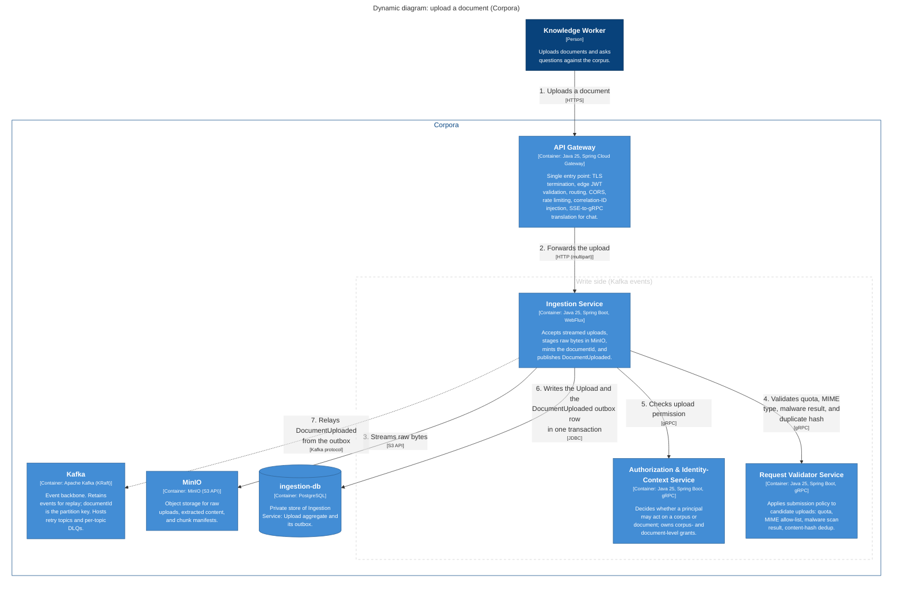
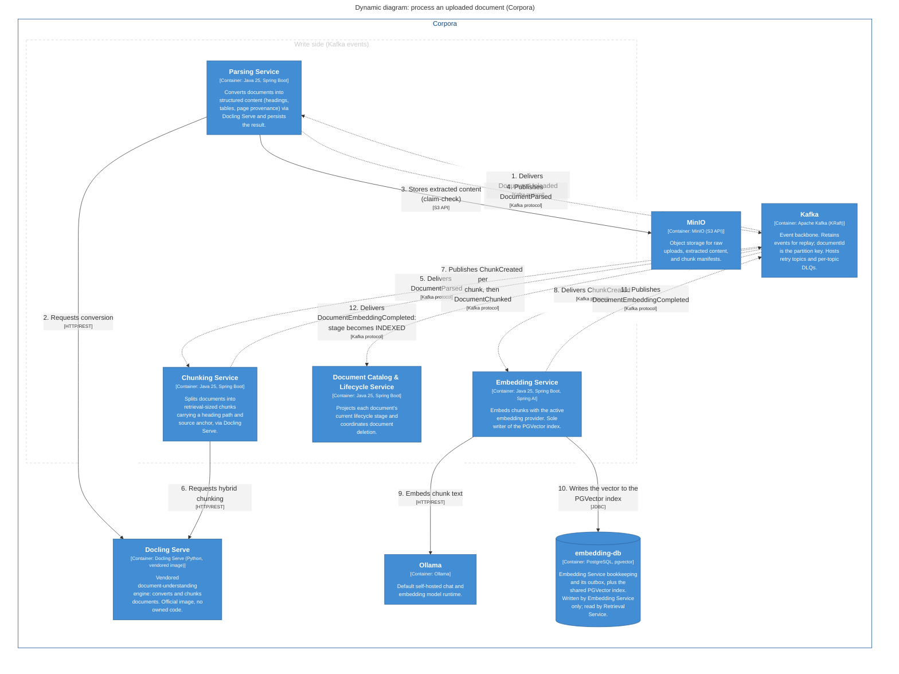
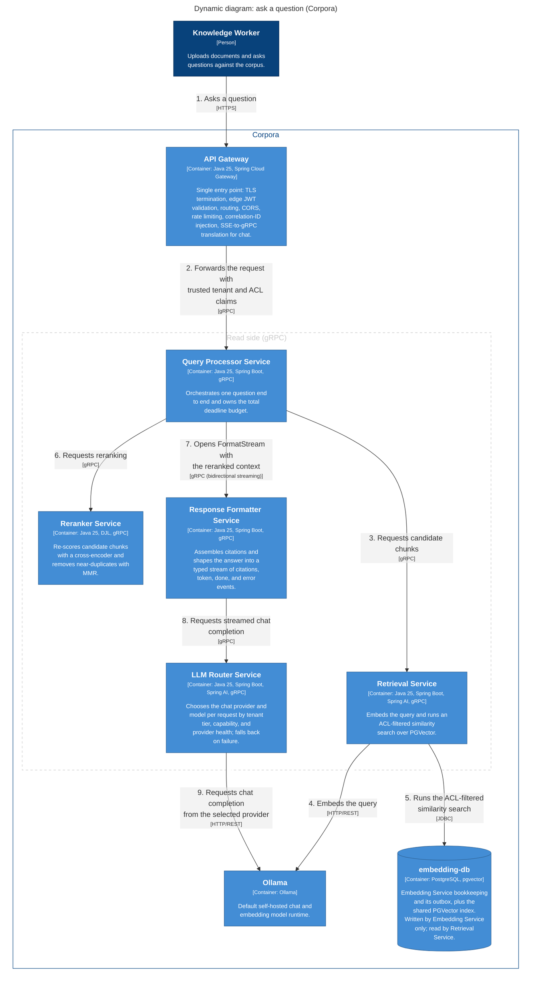
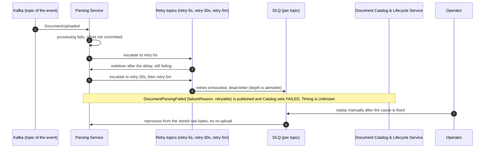

# 6. Runtime view

Four scenarios, chosen because each shows a different consistency or failure property. Participants are the building blocks of [§5](05-building-block-view.md). Key for the C4 dynamic diagrams: numbers give the order of calls; dashed arrow = asynchronous event through Kafka; solid arrow = synchronous call.

## 6.1 A document is uploaded and indexed

Part 1: acceptance and the outbox.

<!-- generated from docs/architecture/workspace.dsl, view "document-upload"; do not edit by hand -->

View key `document-upload`.

Part 2: processing, driven only by Kafka events.

<!-- generated from docs/architecture/workspace.dsl, view "document-processing"; do not edit by hand -->

View key `document-processing`. Failure events (`DocumentParsingFailed`, `DocumentChunkingFailed`, `ChunkEmbeddingFailed`) and the audit fan-out to Audit Service are left out of the picture; see [§6.3](#63-a-processing-stage-keeps-failing) and the [event reference](../../reference/events.md).

Notable aspects:

- **Where atomicity ends.** The `Upload` aggregate and its `DocumentUploaded` outbox row commit in one database transaction. Everything after the relay is eventually consistent.
- **Ordering.** `documentId` is the partition key, so all events of one document are ordered.
- **Claim-check.** Parsed content and chunk manifests are stored in MinIO and referenced by storage key; `ChunkCreated` carries its text inline.
- **Terminal signal.** Embedding Service writes PGVector itself, so `DocumentEmbeddingCompleted` is the terminal "queryable" signal. Document Catalog moves the document to `INDEXED` on that event when `successfullyEmbedded > 0`. A document with some failed chunks is therefore `INDEXED` (R-5 in [§11](11-risks-and-technical-debt.md)).
- **Rejected uploads.** If Request Validator Service rejects a submission it publishes `DocumentUploadRejected`, consumed by Document Catalog and Audit Service.

## 6.2 A question is answered

<!-- generated from docs/architecture/workspace.dsl, view "ask-question"; do not edit by hand -->

View key `ask-question`.

Notable aspects:

- **Trust boundary.** The Gateway validates the JWT. Tenant, ACL groups, and classification ceiling reach Query Processor and Retrieval as trusted gRPC metadata. Retrieval builds the ACL filter from them; the user's own filter hint can only narrow it ([§8.5](08-crosscutting-concepts.md#85-security-and-access-control)).
- **One deadline.** Query Processor owns the total budget and propagates the remaining deadline on every downstream call. The budget value is `TBD` (QS-3).
- **Streaming order.** The `citations` event reaches the client before token streaming begins.
- **Request lifecycle.** An `AnswerRequest` moves through received, understood, retrieved, reranked, generation in progress, answered. It is request-scoped and not persisted.
- **Audit.** Each read-side service publishes its audit event fire-and-forget. Kafka unavailability never fails or delays the answer.

## 6.3 A processing stage keeps failing

Shown for Parsing Service; every write-side consumer follows the same path.

Notable aspects:

- Offsets are committed only after successful persistence. Delivery is at-least-once; `eventId` deduplication makes the effect once.
- Raw bytes are durable in MinIO before processing starts, so recovery never needs a re-upload.
- **Unknown:** the exact moment `DocumentParsingFailed` is published (per attempt or after exhaustion), who moves a message between retry topics, and the replay procedure. The design states only the topic sequence, the DLQ, and that replay is manual. A how-to page is due once the procedure exists.

## 6.4 A document is deleted

Deletion is a saga coordinated by Document Catalog & Lifecycle Service. No diagram is drawn because the confirmation step is not specified.

1. The Gateway forwards the delete request to Document Catalog & Lifecycle Service, which asks Authorization & Identity-Context Service whether the caller may delete the document.
2. Document Catalog publishes `DocumentDeletionRequested`.
3. Ingestion, Parsing, Chunking, and Embedding each consume it, purge their own data (raw bytes, parse and chunk records, extracted content, vectors), and confirm.
4. Document Catalog publishes `DocumentDeleted` with `confirmedPurges[]`; the document becomes `DELETED`. Audit Service records the event.

**Unknown:** how a purge confirmation travels. The event catalog lists no confirmation event, yet `DocumentDeleted` carries `confirmedPurges[]`. See R-8 in [§11](11-risks-and-technical-debt.md).
