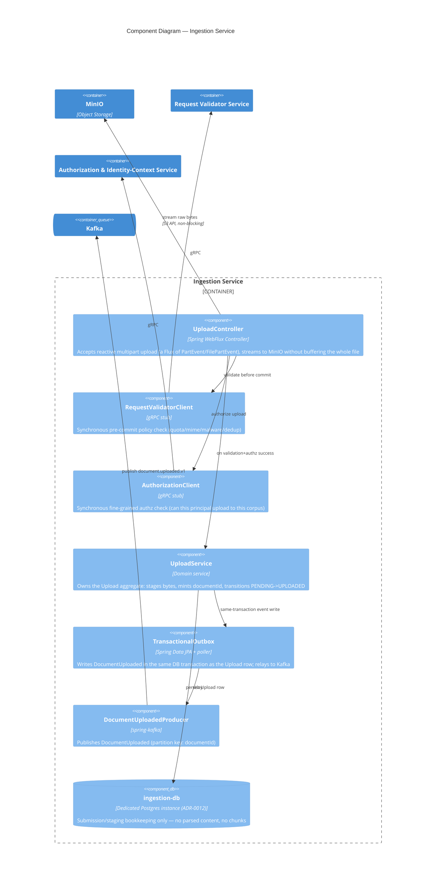

# C4 Model — Level 3: Component Diagram — Ingestion Service

Representative write-side service. Bounded context: `Upload`/`Submission` — see ADR-0001, ADR-0008.

## Notes

- **Transactional outbox, not commit-then-publish**: the `DocumentUploaded` event row is written in the same DB transaction as the `Upload` aggregate write, then relayed by a poller — avoids the dual-write problem (a crash between DB commit and Kafka publish silently losing the event). Every write-side producer follows this same pattern.
- **Retry semantics**: bounded retry with exponential backoff+jitter for transient connectivity failures to Validator/Authorization; 4xx application errors (bad format, denied) fail fast, never retried.
- Because raw bytes are durable in MinIO before any downstream processing begins, retrying a failed `PROCESSING` stage later (Parsing Service) never requires re-upload.
