# C4 Model — Level 3: Component Diagram — Query Processor Service

Read-side orchestrator. Bounded context: `AnswerRequest` — see ADR-0002 for why this chain is synchronous gRPC, not event-driven.

> Diagram source: [`diagrams/c4-component-query-processor-service.mmd`](diagrams/c4-component-query-processor-service.mmd) (Mermaid C4 syntax). GitHub's Mermaid renderer doesn't support C4 diagrams, so this is pre-rendered to SVG. After editing the source, regenerate with:
> `npx --yes @mermaid-js/mermaid-cli -i diagrams/c4-component-query-processor-service.mmd -o diagrams/c4-component-query-processor-service.svg -b white`

## Notes

- **Orchestration, not choreography** (ADR-0002 rationale applied concretely here): `AnswerOrchestrator` is the single owner of the total latency budget, retry/circuit-breaking logic, and the root trace span — a choreographed chain (Retrieval calling Reranker directly, etc.) would have no single place to enforce a bounded total response time.
- **Security invariant enforced at the boundary, not here**: `tenant_id`/`acl_groups`/`classification_ceiling` arrive already-resolved from the Gateway/Keycloak as trusted gRPC metadata. `FilterHintExtractor`'s output is an `ExtractedFilterHint` — see `docs/architecture/ubiquitous-language.md` for the canonical narrow-only guarantee that term carries. The actual ACL `Filter.Expression` is built inside Retrieval Service (see `c4-component-retrieval-service.md`), never here.
- Async audit events (`auditPublisher`) are fire-and-forget: if Kafka is unavailable, the publish is logged and dropped/buffered locally — it never throws or blocks the synchronous response path.
