# C4 Model — Level 3: Component Diagram — Retrieval Service

Owns the single highest-risk piece of logic in the system: ACL enforcement at query time. Bounded context: `CandidateSet` — see ADR-0003, ADR-0012.

> Diagram source: [`diagrams/c4-component-retrieval-service.mmd`](diagrams/c4-component-retrieval-service.mmd) (Mermaid C4 syntax). GitHub's Mermaid renderer doesn't support C4 diagrams, so this is pre-rendered to SVG. After editing the source, regenerate with:
> `npx --yes @mermaid-js/mermaid-cli -i diagrams/c4-component-retrieval-service.mmd -o diagrams/c4-component-retrieval-service.svg -b white`

## Notes

- **Why the `Filter.Expression` is built here, not in Query Processor**: `Filter.Expression` is a `VectorStore`-specific construct; keeping the translation inside Retrieval Service avoids leaking PGVector/Spring AI `VectorStore` API knowledge into a service that has no business knowing it.
- **The one test that must never regress**: user A (group X) and user B (not in X) query the same corpus — B must receive zero candidates/citations from anything ACL'd to X. This is a release-blocking test (see `docs/architecture/implementation-order.md`'s Verification section), and `AccessControlFilterExpressionBuilder` is the component it's testing.
- **Defense in depth**: an optional post-retrieval re-check of each returned chunk's `acl_groups` against the caller's groups is recommended in application code, guarding against any filter-expression bug or partial filter-DSL support, independent of this component's correctness.
- The embedding provider used here must match the one used at index time (Embedding Service) — see ADR-0004's dimension-mismatch fail-fast check, which is enforced at service startup, not per-query.
