# C4 Model — Level 2: Container Diagram

All 14 application services plus infrastructure. See ADR-0001 for why this is a full DDD decomposition rather than a monolith, ADR-0002 for the write-side/read-side protocol split shown here, and ADR-0012 for why every data-owning service gets its own physical Postgres instance rather than a shared cluster.

> Diagram source: [`diagrams/c4-container.mmd`](diagrams/c4-container.mmd) (Mermaid C4 syntax). GitHub's Mermaid renderer doesn't support C4 diagrams, so this is pre-rendered to SVG. After editing the source, regenerate with:
> `npx --yes @mermaid-js/mermaid-cli -i diagrams/c4-container.mmd -o diagrams/c4-container.svg -b white`

## Notes

- Boundary grouping (write side / read side) mirrors ADR-0002's CQRS topology split, not a deployment/network boundary — both groups run in the same Compose network segment; see ADR-0013 for the Docker Compose topology and network segmentation.
- Every data-owning service gets its own dedicated **physical Postgres instance** (ADR-0012, revised from an initial shared-cluster/schema-per-service draft once weighed against this project's own stance against consolidating bounded contexts for operational convenience). No service ever connects to another service's database.
- `embedding-db` is the one deliberate cross-instance exception: it hosts both Embedding Service's own bookkeeping and the shared PGVector index (ADR-0003, ADR-0012). Embedding Service is PGVector's sole writer; Retrieval Service connects to `embedding-db` as a strictly read-only client — the only case in this system where a service reaches into another service's database, and it's read-only by DB role, not by convention alone.
- The release-blocking cross-tenant ACL test and the reranked-retrieval latency budget are documented in `docs/architecture/c4-component-retrieval-service.md` and `docs/architecture/c4-component-query-processor-service.md` respectively — see those files directly rather than an external plan document.
