# C4 Model — Level 1: System Context

Who uses Corpora, and what external systems it depends on. See `docs/architecture/c4-container.md` for the internal service breakdown.

> Diagram source: [`diagrams/c4-context.mmd`](diagrams/c4-context.mmd) (Mermaid C4 syntax). GitHub's Mermaid renderer doesn't support C4 diagrams, so this is pre-rendered to SVG. After editing the source, regenerate with:
> `npx --yes @mermaid-js/mermaid-cli -i diagrams/c4-context.mmd -o diagrams/c4-context.svg -b white`

## Notes

- **Corpora** is the one system box in this diagram; its internal decomposition into 14 services is Level 2 (`c4-container.md`).
- Keycloak is treated as an **existing external system**, not something Corpora operates as application logic — see ADR-0005 for why a separate "Authentication Service" was rejected in favor of Keycloak + a narrower Authorization & Identity-Context Service.
- Docling Serve, Ollama, MinIO, and the observability stack are all self-hosted but modeled as external systems from Corpora's own bounded-context perspective — see ADR-0006 and ADR-0014 for why a vendored container is not the same as owned polyglot code.
